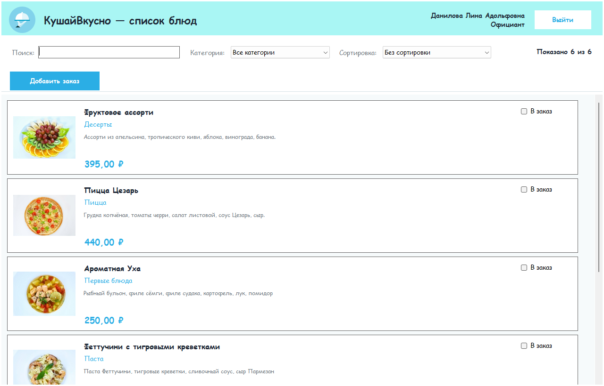

# KushaiVkusno — ИС для сотрудников зала ООО «КушайВкусно»

Демонстрационный экзамен, **Сессия 1**. Информационная система для ресторана:
справочник блюд, оформление заказов, учёт сотрудников. Клиент — Windows Forms (.NET 8),
база данных — MySQL 8.0.



## Состав репозитория

| Папка | Содержание |
| --- | --- |
| `app/KushaiVkusno` | исходный код десктоп-приложения (C#, WinForms, MySqlConnector) |
| `db` | SQL-скрипты создания схемы, импорта данных и проверки целостности |
| `docs` | ER-диаграмма, тестовая документация, руководство пользователя |
| `screenshots` | иллюстрации экранов приложения |

## Стек

* C# / .NET 8 (Windows Forms), MySqlConnector 2.4.0
* MySQL 8.0, схема `isp-45_dolgih_ka_dolgih_schema2`
* СУБД приведена к третьей нормальной форме, все связи обеспечены внешними ключами

## Структура базы данных

| Таблица | Назначение |
| --- | --- |
| `role` | справочник ролей (Официант, Администратор) |
| `employee` | сотрудники — учётные записи системы |
| `category` | категории блюд |
| `dish` | блюда: наименование, цена, состав, изображение, категория |
| `order_status` | статусы заказа (Новый, Готовится, Завершен, Отказ) |
| `orders` | заказы: сотрудник, дата, время, стол, комментарий, статус |
| `order_item` | позиции заказа: блюдо и количество |

Представления `v_order_summary` и `v_order_item_detail` рассчитывают суммы по заказам.
Подробная схема — в файле [`docs/ER-диаграмма.pdf`](docs/ER-диаграмма.pdf).

## Развёртывание

1. Создать схему и загрузить данные:

   ```bash
   mysql -h <сервер> -P <порт> -u <пользователь> -p < db/01_schema.sql
   mysql -h <сервер> -P <порт> -u <пользователь> -p < db/02_data.sql
   ```

2. В папке `app/KushaiVkusno` скопировать `connection.sample.json` в `connection.json`
   и указать параметры своего сервера MySQL. Файл `connection.json` в репозиторий
   не попадает — в нём хранятся учётные данные.

3. Собрать и запустить приложение:

   ```bash
   cd app/KushaiVkusno
   dotnet restore
   dotnet run
   ```

## Учётные записи для входа

| Сотрудник | Роль | Логин | Пароль |
| --- | --- | --- | --- |
| Данилова Лина Адольфовна | Официант | `m4ic8j5qgstw@gmail.com` | `2L6KZG` |
| Иванов Павел Макарович | Официант | `d43zfg9tlsyv@gmail.com` | `uzWC67` |
| Гаврилов Корнелий Давидович | Администратор | `fvkbcamhlj52@gmail.com` | `RSbvHv` |
| Михеева Валерия Филипповна | Администратор | `ilb8rdut0v7e@mail.com` | `JlFRCZ` |

## Возможности

**Официант**

* просмотр списка блюд с фотографией, составом, категорией и ценой;
* поиск по всем полям, фильтр по категории («Все категории» — сброс фильтра),
  сортировка по цене по возрастанию и убыванию — всё в реальном времени;
* счётчик выведенных записей «Показано X из Y»;
* оформление заказа: выбор одной или нескольких позиций, количество, номер стола,
  комментарий, автоматический расчёт позиций, блюд и общей стоимости.

**Администратор**

* добавление, редактирование и удаление блюд (блюдо, входящее в заказ, удалить нельзя);
* просмотр журнала заказов с составом и суммой.

Пароль для входа, номер заказа и дата/время оформления присваиваются автоматически;
одновременно можно открыть только одно окно оформления заказа.

## Документация

* [`docs/ER-диаграмма.pdf`](docs/ER-диаграмма.pdf) — ER-диаграмма, 3НФ
* [`docs/Тестовая документация.docx`](docs/Тестовая%20документация.docx) — 5 тестовых сценариев и результаты прогона
* [`docs/Руководство пользователя 45.docx`](docs/Руководство%20пользователя%2045.docx) — руководство пользователя

## Скриншоты

| Экран | Файл |
| --- | --- |
| Вход в систему | `screenshots/01-login.png` |
| Ввод учётных данных | `screenshots/02-login-filled.png` |
| Список блюд (официант) | `screenshots/03-main-waiter.png` |
| Список блюд (администратор) | `screenshots/04-main-admin.png` |
| Поиск, фильтр и сортировка | `screenshots/05-main-search.png` |
| Оформление заказа | `screenshots/06-order-form.png` |
| Редактирование блюда | `screenshots/07-dish-edit.png` |
| Журнал заказов | `screenshots/08-orders.png` |
| Добавление блюда | `screenshots/09-dish-add.png` |

## Автор

Долгих К. А., группа ИСП-45, 2026 г.
